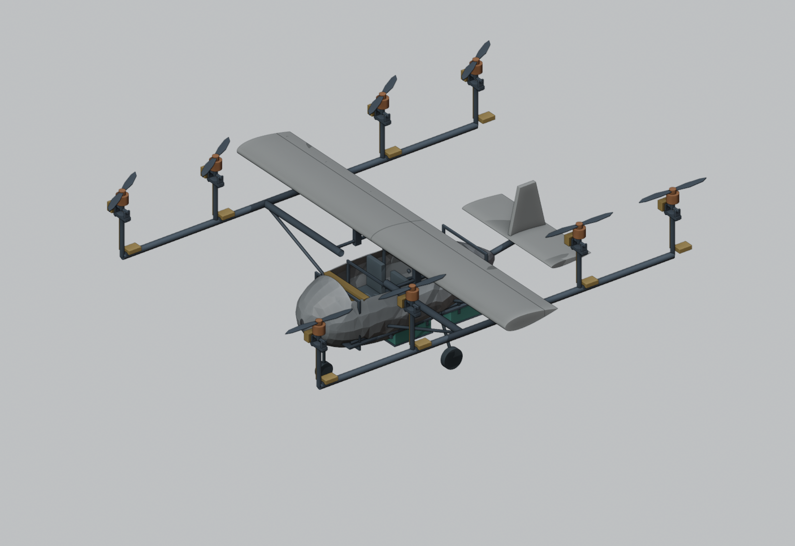

# E8 aircraft CAD and preliminary design study

**Educational concept — no fabrication or flight release.** A 167-component assembled model for the two-person, eight-motor concept, plus a bounded sizing study and sourced component shortlist. Rotor-out, thermal, structural detail and control design remain open. This is not a proven cheapest or globally optimal aircraft.

## Open the 3D model

- **No installation:** download [E8_3D_Viewer_Offline.html](viewer/E8_3D_Viewer_Offline.html?raw=true), then double-click it. Orbit, zoom, hide the shell, inspect batteries/structure, remove the wing/tail, and tilt the rotors. GitHub shows HTML source until you download it.
- **GitHub 3D preview:** open [winged STL](cad/E8_Winged_Hover.stl) or [wingless STL](cad/E8_Wingless_Hover.stl). GitHub may take time to render or require download on some devices.
- **CAD:** download [FreeCAD assembly](cad/E8_Concept_Assembly.FCStd?raw=true), [winged hover STEP](cad/E8_Winged_Hover.step?raw=true), [winged cruise STEP](cad/E8_Winged_Cruise.step?raw=true), or [wingless STEP](cad/E8_Wingless_Hover.step?raw=true). Units: mm.
- **Everything:** [complete aircraft concept ZIP](https://github.com/Rpirayesh/E8-eVTOL-Design-Explorer/raw/refs/heads/main/downloads/E8_Aircraft_Concept_0_1.zip).

## Study and inspect

| File | Contents |
| --- | --- |
| [Design report](DESIGN_REPORT.md) | Assumptions, equations, limitations, mass, energy, structures and unresolved failures |
| [BOM](BOM.csv) | Candidate parts, quantities, mass allowances, source IDs and quotation gaps |
| [Sources](sources/README.md) | Manufacturer specifications and dated prices; no vendor approvals implied |
| [Selected parameters](selected_design.json) | CAD and sizing inputs chosen from the finite grid |
| [Analysis results](analysis/results.json) | Winged/wingless comparison, sensitivities and static rotor-out proxies |
| [Trade study](analysis/trade_study.csv) | 624 candidates; 46 winged candidates pass the listed scalar screens |
| [Independent reviews](reviews/README.md) | Separate numerical, geometry/software and sourcing/engineering reviews |
| [Rebuild scripts](tools) | Reproducible CAD, analysis, viewer and document generation |

Selected study point: 1054.8 kg including growth, 12 m² wing, 9 m span, 1.7 m rotors, 140 km/h. Estimates: 210.6 kW hover electrical load and 26.3 km energy-based range under the listed assumptions. **All eight single-rotor-out cases exceed the conservative continuous-power screen.** Battery heat rejection and actual rotor performance are unresolved.

Only bare cells have a selected dated bulk price: $19,200; this is not the aircraft price. Motors, inverters, propellers, airframe and qualification require quotations. The much cheaper drone propulsion shortlist fails the full-scale thrust requirement.

The original [offline performance explorer](../E8_eVTOL_Explorer_Offline.html) remains available with its own defaults and assumptions. This new study adds simple battery-resistance losses and should not be represented as validation of the original illustrative defaults.
